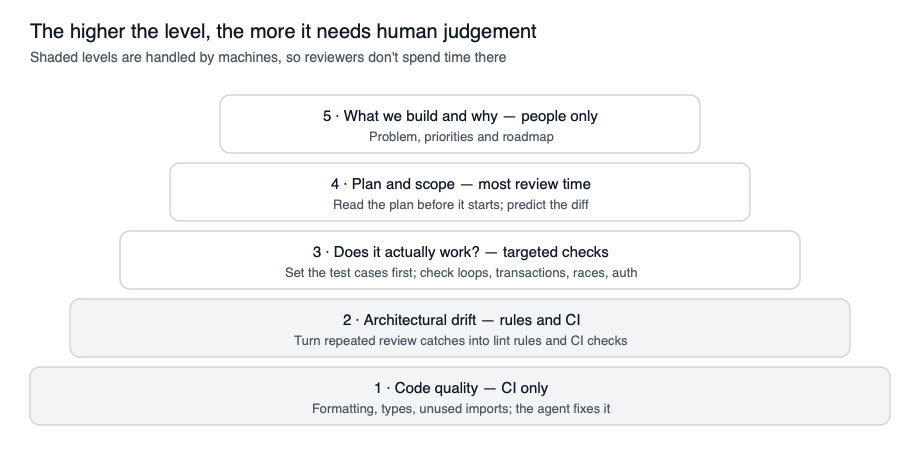

# **Hierarchy of verification**

**Status:** Proposal. A way of dividing review responsibility; not yet agreed as a team.  
**Responds to:** [review fatigue and automation bias](../guides/risks-and-mitigations.md#review-fatigue-and-automation-bias). The reasoning is in [HUMANS.md](../../HUMANS.md#hierarchy-of-verification).

Push everything mechanical (formatting, types, recurring drift) into tooling, so human attention goes on what tooling can't judge: whether it actually works, the plan and scope, and what we build and why.

This hierarchy of verification attempts to delineate responsibilities at different levels and provide a reference for what type of tooling / manual audits are needed when and where.

* **1 · Code quality.** Formatting, types, unused imports. CI catches it, the agent fixes it, nobody discusses it in review.  
* **2 · Architectural drift.** If you keep catching the same kind of drift by hand (wrong imports, edits to shared code, duplicate helpers), turn it into a lint rule or CI check so you don’t have to.  
* **3 · Does it actually work?** Decide what the tests should check before the agent writes the code. Then check for the things tests rarely catch: queries in loops, missing transactions, race conditions, auth gaps.  
* **4 · Plan and scope.** Read the agent’s plan properly before it starts, and know roughly what the diff should look like before opening it. This is where review time is best spent.  
* **5 · What we build and why.** That stays with us.
