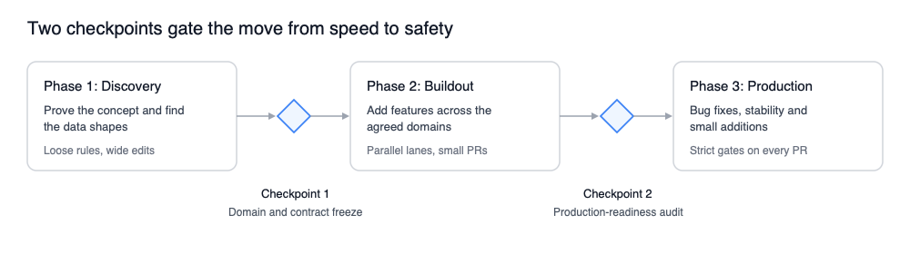

# **Project lifecycle**

**Status:** Proposal. The phases reflect my own projects so far; the checkpoint lists are examples, not yet used as a formal gate.  
**Responds to:** [architectural drift and plan drift](../../HUMANS.md#risks). The reasoning is in [HUMANS.md](../../HUMANS.md#project-lifecycle).

This proposal explores how the principles and approaches outlined in the main guide can be translated into a project lifecycle.

The primary concern here is the human bottleneck. We can frontload human review efforts, we can do routine or ad hoc reviews, or we can defer to the end. Regardless, the bill comes due.

With that in mind, we might then consider some repayment options:

- **Pay-as-you-go:** Modular gating; non-negotiable for load-bearing invariants.
- **Tranche checkpoints:** Sprinting through bounded feature sets, then freezing the workspace to settle the debt before moving on.
- **The balloon payment:** Zero review upfront; your users do the reviewing.

The reality is we might incorporate different repayment options in one project.

Here I propose a checkpoints approach and how a project may transition from one mode to another.

## Phases and checkpoints

This is an approach which attempts to reconcile a high-velocity, AI-driven kick-off with latter-stage maturity, stability and high confidence, in cases where the spec is not necessarily fixed up front. It assumes the vast majority of code (if not all of it) throughout the project lifecycle is generated by AI.

Centrally, the idea is to switch "mode" from huge, sweeping changes at the beginning to targeted and bounded work when it reaches a stable state.

We change mode deliberately, at two checkpoints, rather than drifting into a codebase that looks finished but that nobody really understands. From "feature complete" to "production ready".

### **Phase 1: Discovery**

The spec is defined but the solutions are theoretical. We might want to move fast to stress test the assumptions. We do not want to be slowed down examining code line-by-line, but we do want to validate the output and pin down the stable data models, types, structures, patterns and so on. All the things that will become our baseline for acceptance of future work.

At the end of this phase we want to clean up and streamline all generated docs to represent the stable state of the project.

### **Checkpoint 1: domain and contract freeze (example)**

* ☐ Core data models, schemas and types are stable  
* ☐ Code is organised into bounded domain folders (e.g. src/modules/billing)  
* ☐ Workspace package boundaries and the shared UI package are locked  
* ☐ An agent pass has removed duplicate helpers, unused packages and dead scaffolding from discovery  
* ☐ Agent instructions (CLAUDE.md) are in the repo root: architecture rules, preferred libraries, things not to do  
* ☐ Each domain has its short README of rules and contracts

### **Phase 2: Buildout**

At the end of this phase, the product should be "feature complete", but should not be assumed to be "production ready". This is where we need to dig deeper, challenge prior assumptions and ensure we are not releasing something no developer on the team fully understands.

### **Checkpoint 2: production-readiness audit (example)**

* ☐ Every external boundary (APIs, webhooks, user input) is validated at runtime  
* ☐ Every critical flow has integration tests with human-verified assertions  
* ☐ Critical queries and state changes checked for N+1s, missing transactions and race conditions  
* ☐ Security pass: no credentials in the repo or agent logs, no hardcoded keys, no overly broad permissions, secret scanning in CI  
* ☐ Lint rules for domain boundaries and duplicate detection are enforced in CI  
* ☐ Shared configs, migrations and libraries are frozen with CODEOWNERS, Git hooks and read-only mounts

### **Phase 3: Production**

The product is "mature", in production, and undergoing ongoing feature additions, bug fixes, and maintenance. Our strictest rules are in place and the expectation for agent output is predictable and manageable. 
